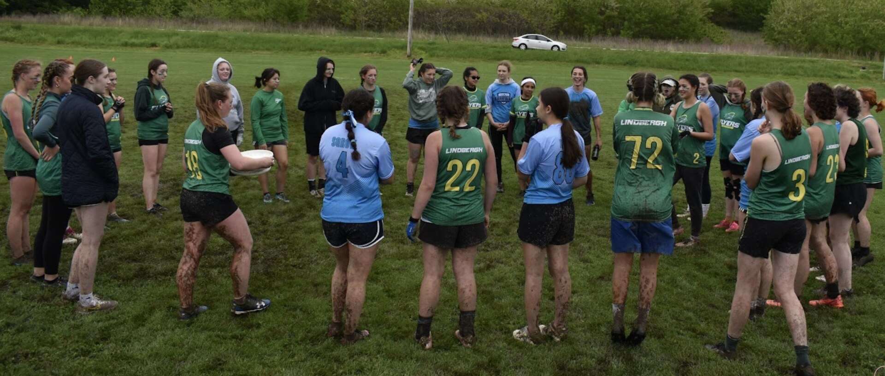
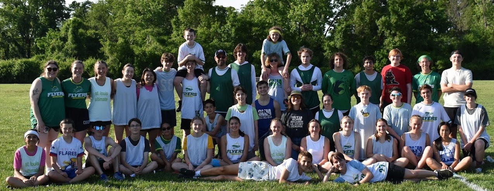
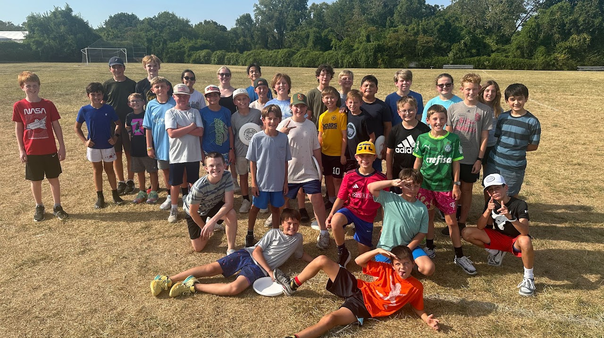
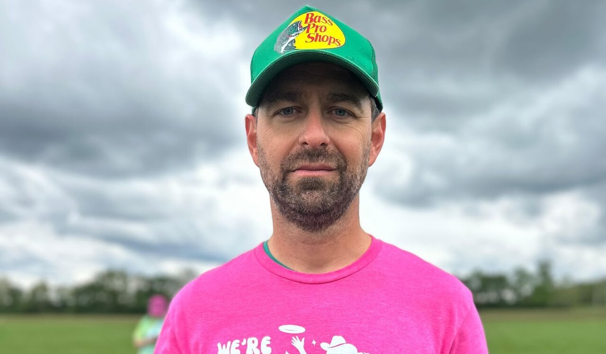
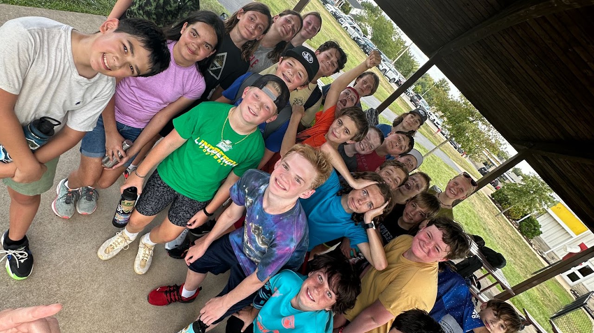
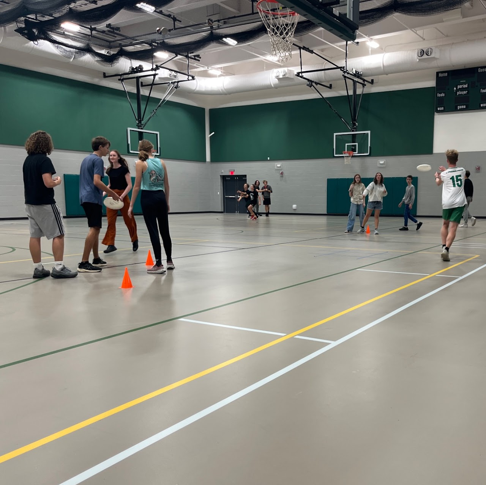
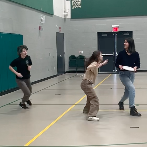
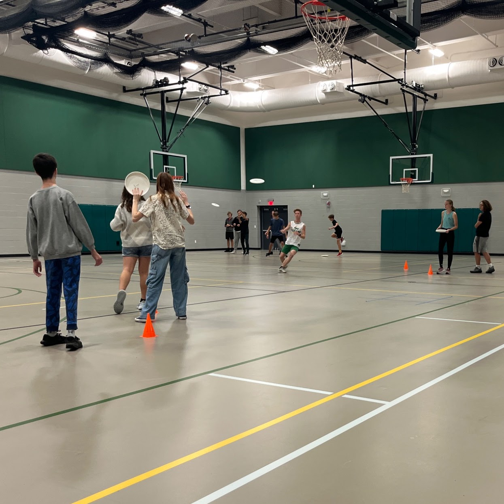
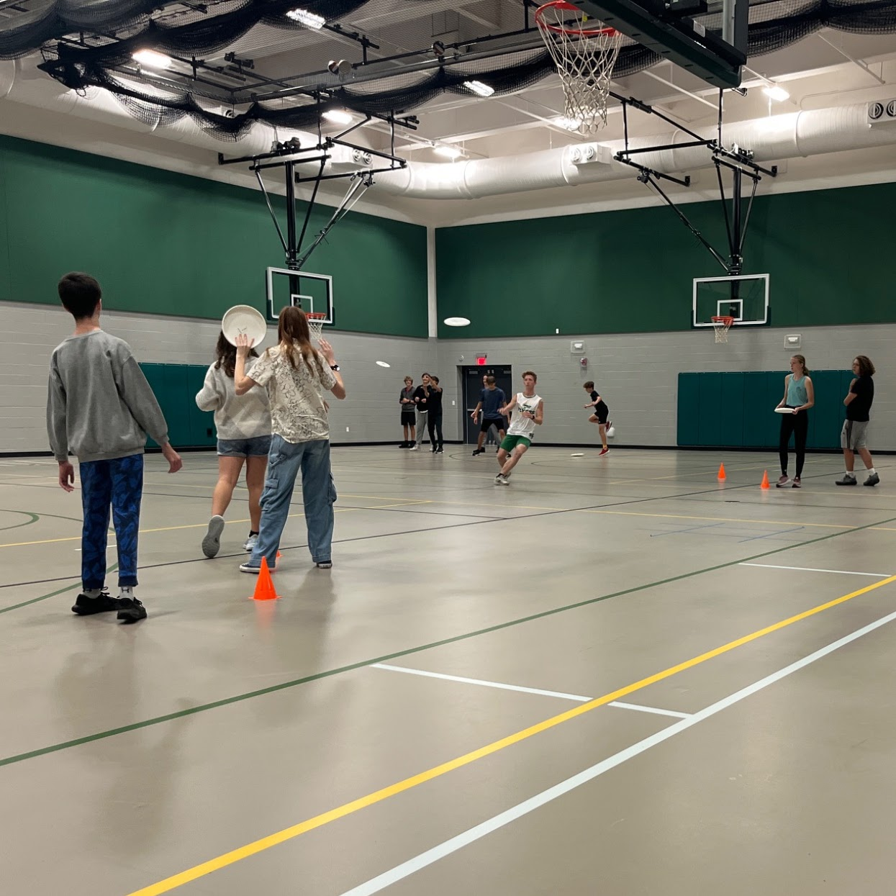
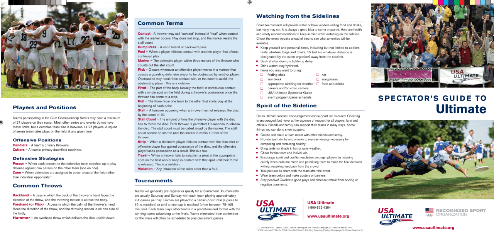

# Lindbergh Ultimate Image Asset Map

Last reviewed: **2026-10-25**

Scope: every image imported by `src/**/*.jsx`, browser icons referenced by
`index.html`, hosted media, PDFs and PDF previews in `public/docs/`, and unused
files in `src/assets/` and `public/`.

> **Content notice:** names, email addresses, phone numbers, and PDFs in the
> public UI are fictional placeholders. The program photos are real photos
> restored from the original site; use them only with the program's consent.
> Two portraits were cropped to remove visible clipboard text/name labels.
> See the root `README.md` and `docs/Postmortem.md` for the anonymization notes.

Use this as the source of truth when checking whether an image name matches the
page or section that displays it.

---

## Where each used image appears (route view)

| Route / area | Images used | What the visitor sees |
| --- | --- | --- |
| Global header/nav (all public routes) | `ultimateLogoTransparent.png` | Sticky navbar with the Lindbergh Ultimate logo and current-page label |
| `/` Home | `champions.jpg`, `welcome.png`, `ultimateRules.png`, `circle.jpg`, `swag.png` | Team banner, welcome photo, field-size rules diagram, Spirit Circle photo, team-store swag graphic |
| `/middle-school` | `circle.jpg`, `fallMiddleSchoolClub.jpg`, `5week.jpg` | Team-circle hero; Fall After School Club photo; 5 Week Summer Camps photo |
| `/high-school` | `circle.jpg`, `coach-1.jpg`, `coach-2.jpg`, `coach-3.jpg`, `coach-4.jpg`, PDF cover previews | Team-circle hero; four coach photos; interest-meeting slides and season-letter cards with Open/Download links |
| `/coaching-apprenticeship` | `circle.jpg` | Team-circle hero; coaching apprenticeship copy and application link |
| `/media` | `circle.jpg` and twelve gallery covers (see below) | Team-circle hero; historical photo-gallery covers |
| `/play-opportunities` | `circle.jpg`, `groupme.jpg`, `slua.png` | Team-circle hero; Lindbergh Players Pickup GroupMe card; Saint Louis Ultimate Association partner card |
| `/power-lunch` | `circle.jpg`, `Lindbergh Ultimate - Power Lunch.jpg`, `5week.jpg`, `lunch2.png`, `3.jpg` | Team-circle hero; four Power Lunch gallery photos |
| `/families` | `circle.jpg`, `wordCloud.png`, `spectatorGuide.png` | Team-circle hero; word-cloud image; USA Ultimate spectator guide excerpt |
| `/booster-club` | `circle.jpg`, `coach-1.jpg` … `coach-4.jpg`, `booster-1.jpg` … `booster-5.jpg`, `blankAvatar.svg` | Team-circle hero; coach and booster photos; blank avatar for open seats |
| `/usa-ultimate` | `circle.jpg` | Team-circle hero |
| `/fundraiser` | `circle.jpg`, `champions.jpg` | Faint team-circle hero; team photo in the campaign card |
| `/admin`, `/admin/login` | `ultimateLogoTransparent.png` | Admin header and login logo |
| `/interest-form`, `/registration`, `/calendar`, `/sportsyou` | none | No local images |

> `Header` and the navbar logo come from `Layout`; `/fundraiser` renders its own
> `Header`/`Footer`. The sticky navbar lives on `components/Header.jsx` so it
> stays pinned across the public site.

---

## Used assets (asset view)

### Brand and global

| Preview | File | Size | Used in | Context / notes |
| --- | --- | --- | --- | --- |
|  | `src/assets/ultimateLogoTransparent.png` | 1536×988 · 148.6 KB | `components/Navbar.jsx`, `admin/AdminLayout.jsx`, `admin/AdminLogin.jsx` | Main transparent logo. `ultimateLogo.png` is an unused smaller/older logo. |
|  | `src/assets/circle.jpg` | 1920×817 · 332 KB | `components/Header.jsx`, `components/Rules.jsx`, `pages/MiddleSchool.jsx`, `pages/HighSchool.jsx`, `pages/Media.jsx`, `pages/PlayOpportunities.jsx`, `pages/PowerLunch.jsx`, `pages/Families.jsx`, `pages/BoosterClub.jsx`, `pages/USUltimate.jsx`, `pages/Fundraiser.jsx` | Real team-circle photo. Used as a low-opacity hero/banner background on many pages and as the “Spirit Circle” image on Home > Rules. |

### Home page (`/`)

| Preview | File | Size | Used in | Context / notes |
| --- | --- | --- | --- | --- |
|  | `src/assets/champions.jpg` | 1275×495 · 351 KB | `pages/Home.jsx`, `pages/Media.jsx`, `pages/Fundraiser.jsx` | Team photo used as the Home banner, a Media gallery cover, and the Fundraiser campaign image. |
|  | `src/assets/welcome.png` | 1193×670 · 1.3 MB | `components/Welcome.jsx` (Home) | Real team huddle photo in the welcome section. |
|  | `src/assets/ultimateRules.png` | 3584×1514 · 786 KB | `components/Rules.jsx` (Home) | Field-size diagram under “Ultimate in 10 Simple Rules.” `rules.png` is an unused smaller duplicate. |
|  | `src/assets/swag.png` | 1280×1194 · 1.3 MB | `components/Swag.jsx` (Home) | Team-store/swag collage. |

### Middle School page (`/middle-school`)

| Preview | File | Size | Used in | Context / notes |
| --- | --- | --- | --- | --- |
|  | `src/assets/fallMiddleSchoolClub.jpg` | 1280×719 · 408 KB | `pages/MiddleSchool.jsx` | Fall After School Club card photo. |
|  | `src/assets/5week.jpg` | 1280×719 · 295 KB | `pages/MiddleSchool.jsx`, `pages/PowerLunch.jsx` | 5 Week Summer Camps card and Power Lunch gallery photo. |

### High School page (`/high-school`)

| Preview | File | Size | Used in | Context / notes |
| --- | --- | --- | --- | --- |
|  | `src/assets/coach-1.jpg` | 1206×800 · 245 KB | `pages/HighSchool.jsx`, `pages/BoosterClub.jsx` | Real coach photo (fictional display name “Taylor ‘T’ Quinn”). Cropped to remove clipboard papers. |
|  | `src/assets/coach-2.jpg` | 545×545 · 94 KB | `pages/HighSchool.jsx`, `pages/BoosterClub.jsx` | Real coach photo (fictional display name “Morgan Blake”). |
|  | `src/assets/coach-3.jpg` | 946×946 · 173 KB | `pages/HighSchool.jsx`, `pages/BoosterClub.jsx` | Real coach photo (fictional display name “Casey ‘Brooks’ Brooks”). |
|  | `src/assets/coach-4.jpg` | 1280×750 · 110 KB | `pages/HighSchool.jsx`, `pages/BoosterClub.jsx` | Real coach/booster photo (fictional display name “Jordan Ellis”). Cropped to remove the “COACH JOE” clipboard label. |

### High School documents (`/high-school`)

| File | Size | Used in | Context / notes |
| --- | --- | --- | --- |
| `public/docs/Flyers-Info-Meeting-Slides-2026.pdf` | 56.6 KB · 12 pages | `pages/HighSchool.jsx` | Regenerated dummy interest-meeting slide deck. |
| `public/docs/Flyers-Info-Meeting-Slides-2026-cover.png` | 540×304 · 18.2 KB | `pages/HighSchool.jsx` | First-page preview for the slides card. |
| `public/docs/Lindbergh-Ultimate-2026-Season-Letter-to-Families.pdf` | 38.4 KB · 5 pages | `pages/HighSchool.jsx` | Regenerated dummy season letter/info packet. |
| `public/docs/Lindbergh-Ultimate-2026-Season-Letter-to-Families-cover.png` | 459×594 · 65.6 KB | `pages/HighSchool.jsx` | First-page preview for the season-letter card. |

### Media page (`/media`)

The gallery covers use real program photos. Some historical galleries reuse the
same source image because the original archive contains duplicate photos.

| Preview | File | Size | Used in | Context / notes |
| --- | --- | --- | --- | --- |
|  | `src/assets/Lindbergh Ultimate - Media.jpg` | 1280×731 · 273 KB | `pages/Media.jsx` | Team photo gallery cover. |
|  | `src/assets/Lindbergh Ultimate - Grades 3-8.jpg` | 1280×719 · 408 KB | `pages/Media.jsx` | Middle School gallery cover. |
|  | `src/assets/fall3-5.jpg` | 1280×719 · 313 KB | `pages/Media.jsx` | All-Star/community gallery cover. |
|  | `src/assets/Lindbergh Ultimate - Play Opportunities.jpg` | 1280×719 · 265 KB | `pages/Media.jsx` | Team gallery cover. |
|  | `src/assets/Lindbergh Ultimate - Power Lunch.jpg` | 1280×1279 · 222 KB | `pages/Media.jsx` | Power Lunch gallery cover. |
|  | `src/assets/fallMiddleSchoolClub.jpg` | 1280×719 · 408 KB | `pages/Media.jsx` | Middle School gallery cover. |
|  | `src/assets/groupme.jpg` | 1280×719 · 265 KB | `pages/Media.jsx` | GroupMe/team gallery cover. |
|  | `src/assets/lunch1.jpg` | 1280×1279 · 222 KB | `pages/Media.jsx` | Power Lunch gallery cover. |
|  | `src/assets/lunch2.png` | 294×294 · 117 KB | `pages/Media.jsx`, `pages/PowerLunch.jsx` | Power Lunch gallery photo. |
|  | `src/assets/lunch3.jpg` | 1245×1245 · 242 KB | `pages/Media.jsx` | Indoor practice gallery cover. |
|  | `src/assets/3.jpg` | 1245×1245 · 242 KB | `pages/Media.jsx`, `pages/PowerLunch.jsx` | Indoor practice/Power Lunch gallery photo. |

### Families page (`/families`)

| Preview | File | Size | Used in | Context / notes |
| --- | --- | --- | --- | --- |
|  | `src/assets/wordCloud.png` | 1280×1047 · 590 KB | `pages/Families.jsx` | Supplied word cloud in the “Describe Lindbergh Ultimate in Three Words” section. It has a solid white background, so it is displayed on a cream rounded card. |
|  | `src/assets/spectatorGuide.png` | 1280×603 · 1.0 MB | `pages/Families.jsx` | USA Ultimate spectator guide excerpt in the “For Spectators & Families” card. |

### Booster Club page (`/booster-club`)

The photos are real program photos; the names and email addresses are fictional
placeholders.

| Preview | File | Size | Used in | Context / notes |
| --- | --- | --- | --- | --- |
|  | `src/assets/coach-4.jpg` | 1280×750 · 110 KB | `pages/BoosterClub.jsx` | President photo (fictional display name “Jordan Ellis”). |
|  | `src/assets/booster-1.jpg` | 1280×1280 · 267 KB | `pages/BoosterClub.jsx` | Secretary photo (fictional display name “Riley Hayes”). |
|  | `src/assets/booster-2.jpg` | 1078×1078 · 353 KB | `pages/BoosterClub.jsx` | Co-Treasurer photo (fictional display name “Avery Bennett”). |
|  | `src/assets/booster-3.png` | 321×321 · 148 KB | `pages/BoosterClub.jsx` | Co-Treasurer photo (fictional display name “Cameron Price”). |
|  | `src/assets/booster-4.jpg` | 1280×1280 · 351 KB | `pages/BoosterClub.jsx` | Vice-President photo (fictional display name “Reese Morgan”). |
|  | `src/assets/booster-5.jpg` | 1280×1280 · 419 KB | `pages/BoosterClub.jsx` | Alumni Rep photo (fictional display name “Quinn Collins”). |
|  | `src/assets/coach-1.jpg` | 1206×800 · 245 KB | `pages/BoosterClub.jsx`, `pages/HighSchool.jsx` | Coach photo (fictional display name “Taylor ‘T’ Quinn”). |
|  | `src/assets/coach-2.jpg` | 545×545 · 94 KB | `pages/BoosterClub.jsx`, `pages/HighSchool.jsx` | Coach photo (fictional display name “Morgan Blake”). |
|  | `src/assets/coach-3.jpg` | 946×946 · 173 KB | `pages/BoosterClub.jsx`, `pages/HighSchool.jsx` | Coach photo (fictional display name “Casey ‘Brooks’ Brooks”). |
|  | `src/assets/blankAvatar.svg` | 400×400 · <1 KB | `pages/BoosterClub.jsx` | Neutral silhouette used for the three open positions (Middle School Rep, Gxrls Team Historian, Boys Team Historian). The card keeps the role label and a dashed yellow border. |

All portraits and the blank avatar use the `.booster-photo-shadow` utility in
`src/index.css`, which adds a Lindbergh-yellow glow.

### Power Lunch page (`/power-lunch`)

| Preview | File | Size | Used in | Context / notes |
| --- | --- | --- | --- | --- |
|  | `src/assets/Lindbergh Ultimate - Power Lunch.jpg` | 1280×1279 · 222 KB | `pages/PowerLunch.jsx` | Main Power Lunch gallery photo. |
|  | `src/assets/5week.jpg` | 1280×719 · 295 KB | `pages/PowerLunch.jsx` | Summer camp gallery photo. |
|  | `src/assets/lunch2.png` | 294×294 · 117 KB | `pages/PowerLunch.jsx` | Power Lunch gallery photo. |
|  | `src/assets/3.jpg` | 1245×1245 · 242 KB | `pages/PowerLunch.jsx` | Indoor practice gallery photo. |

### Partner logos

| Preview | File | Size | Used in | Context / notes |
| --- | --- | --- | --- | --- |
|  | `src/assets/slua.png` | 1028×565 · 617 KB | `pages/PlayOpportunities.jsx` | St. Louis Ultimate Association partner card. |

---

## Browser icons (`public/`)

| File | Size | Referenced by | Notes |
| --- | --- | --- | --- |
| `public/favicon.ico` | 15.0 KB | `index.html` (`/favicon.ico`) | Primary browser icon. Good. |
| `public/favicon-32x32.png` | 1.3 KB | `index.html` | 32×32 PNG icon. |
| `public/favicon-16x16.png` | 0.6 KB | `index.html` | 16×16 PNG icon. |
| `public/apple-touch-icon.png` | 14.4 KB | `index.html` | 180×180 Apple touch icon. |
| `public/android-chrome-192x192.png` | 15.2 KB | not referenced | Add a `site.webmanifest` to use these, or remove them. |
| `public/android-chrome-512x512.png` | 73.9 KB | not referenced | Same as above. |
| `public/favicon.svg` | 0.3 KB | not referenced | **Misnamed:** the file contains PNG data, not SVG. It is identical to `LindberghSchoolsfavicon_1.png`. Remove it or replace it with a real SVG. |
| `public/icons.svg` | 4.9 KB | not referenced | Unused icon sprite. Verify before deleting. |

---

## External images / placeholders

| Source | Where | Notes |
| --- | --- | --- |
| YouTube embed `PrinnxHyWlo` | `components/WhatIs.jsx` | “What is Ultimate?” video. |
| YouTube embeds with empty IDs | `pages/Media.jsx` | Two video placeholders until real YouTube IDs are added. |

---

## Unused assets

These files are **not imported anywhere** in the current React code. Keep the
ones you still need; remove the rest before pushing to GitHub to keep the repo
small.

| File | Size | What it appears to be / recommendation |
| --- | --- | --- |
| `src/assets/openPosition.jpg` | 190×190 · 5.3 KB | “OPEN POSITION” stamp graphic. No longer used; open Booster Club seats now use `blankAvatar.svg`. |
| `src/assets/openPositionStamp.jpg` | 262×262 · 30.5 KB | Another “OPEN POSITION” stamp. No longer used. |
| `src/assets/Lindbergh Ultimate - Play Opportunities.png` | 647×364 · 60.4 KB | **Not a photo:** it is the St. Louis Ultimate Association (STLUA) logo. Duplicate of `slua.png`; use `slua.png` on `/play-opportunities`. |
| `src/assets/Lindbergh Ultimate - Power Lunch.png` | 294×294 · 104 KB | Thumbnail-sized duplicate of the Power Lunch photo. |
| `src/assets/rules.png` | 825×334 · 20.1 KB | Small duplicate of `ultimateRules.png` field diagram. |
| `src/assets/ultimateLogo.png` | 130×76 · 5.2 KB | Small/older logo; the transparent 1536×988 version is used instead. |
| `src/assets/LindberghSchools.png` | 192×64 · 2.6 KB | Lindbergh Schools logo; not referenced. |
| `src/assets/LindberghSchoolsfavicon_1.png` | 24×24 · 0.3 KB | Old favicon; identical to `public/favicon.svg`. |

---

## Notes on anonymization

- Real coach, booster, parent, and player names were replaced with fictional
  names throughout the React pages, seed data, and PDFs.
- Real email addresses were replaced with `example.com` addresses.
- Real program photos were restored to the public pages with generic filenames.
  `coach-1.jpg` and `coach-4.jpg` were cropped to remove visible clipboard
  text/name labels. Confirm consent before publishing the repository.
- The two PDFs in `public/docs/` and the duplicate season-letter PDF in
  `src/assets/` were regenerated as sample documents with “SAMPLE DOCUMENT -
  DUMMY DATA” footers.
- The unused `src/assets/Join Sports You.pdf` invitation was sanitized: the real
  access code and QR code were replaced with `SAMPLE-CODE` and a dummy QR grid.
- The SportsYou access code in `src/pages/SportsYou.jsx` and
  `server/src/seed/seedData.js` is now `SAMPLE-CODE`.
- `server/.env` is git-ignored. It still contains local development credentials
  and should never be committed or shared.

---

## Quick verification commands

```bash
# List every image file and its dimensions
find src/assets public -type f \( -iname '*.png' -o -iname '*.jpg' -o -iname '*.jpeg' -o -iname '*.webp' -o -iname '*.gif' -o -iname '*.svg' -o -iname '*.ico' \) -print

# Find every image import in the React source
grep -RIn --include='*.jsx' --include='*.js' -E '\.(png|jpe?g|webp|gif|svg|avif)' src

# Find duplicate files by hash (macOS/Linux with shasum)
find src/assets public -type f -print0 | xargs -0 shasum -a 256 | sort
```
