# Lindbergh Ultimate Image Asset Map

Last reviewed: **2026-10-24**  
Scope: every image imported by `src/**/*.jsx`, browser icons referenced by `index.html`, hosted media, PDFs and PDF previews in `public/docs/`, and unused files in `src/assets/` and `public/`.

Use this as the source of truth when checking whether an image name matches the page or section that displays it.

---

## TL;DR — please verify these first

1. **High School coach photos are resolved.**
   The four coach cards now use `gabby.jpg` for **Gabby Lavezzi**, `coachT.jpg` for **Kristina “T” Gu**, `goods.jpg` for **Loren “Goods” Goodrich**, and `joe.jpg` for **Joe Corcoran**. The same portraits are used on the Booster Club.
2. **Both Middle School program cards now use `Lindbergh Ultimate - Grades 3-8.jpg`.**
   `fallmiddle.jpg` was a byte-identical duplicate and has been removed. `5week.jpg` shows a different middle-school group and is still an option if the summer-camp card should have a separate photo.
3. **`5week.jpg` is in the Power Lunch gallery, not the 5 Week Summer Camps card.**
   It is a middle-school group under a pavilion, not a Power Lunch gym photo.
4. **Media gallery covers are reused across different seasons.**
   `Grades 3-8.jpg`, `Media.jpg`, `Play Opportunities.jpg`, and `Power Lunch.jpg` are used for multiple historical galleries. Verify each cover matches the gallery title/year.
5. **The old favicon link was broken.**
   `index.html` pointed at `./src/assets/lindberghUltimate.png`, which does not exist. It now uses `public/favicon.ico`, `favicon-32x32.png`, `favicon-16x16.png`, and `apple-touch-icon.png`.
6. **Several images are very large.**
   `circle.png` is **8.5 MB**, `dave.png` is **1.7 MB**, `welcome.png` is **1.3 MB**, and `swag.png` is **1.3 MB**. These should be compressed or converted to WebP before production.

---

## Where each used image appears (route view)

| Route / area | Images used | What the visitor sees |
| --- | --- | --- |
| Global header/nav (all public routes) | `ultimateLogoTransparent.png` | Sticky navbar with the Lindbergh Ultimate logo and current-page label |
| `/` Home | `welcome.png`, `ultimateRules.png`, `circle.png`, `swag.png` | Welcome photo; field-size rules diagram; Spirit Circle photo; team-store swag graphic |
| `/middle-school` | `circle.png`, `Lindbergh Ultimate - Grades 3-8.jpg` | Hero background; Fall After School Club card; 5 Week Summer Camps card |
| `/high-school` | `circle.png`, `gabby.jpg`, `coachT.jpg`, `goods.jpg`, `joe.jpg`, PDF cover previews | Hero background; four coach cards; interest-meeting slides and season-letter cards with Open/Download links |
| `/coaching-apprenticeship` | `circle.png` | Hero background; coaching apprenticeship copy and application link |
| `/media` | `circle.png`, `Lindbergh Ultimate - Grades 3-8.jpg`, `Lindbergh Ultimate - Media.jpg`, `Lindbergh Ultimate - Play Opportunities.jpg`, `Lindbergh Ultimate - Power Lunch.jpg` | Hero background; nine photo-gallery cover cards |
| `/play-opportunities` | `circle.png`, `Lindbergh Ultimate - Play Opportunities.jpg`, `slua.png` | Hero background; Lindbergh Players Pickup GroupMe card; Saint Louis Ultimate Association partner card |
| `/power-lunch` | `circle.png`, `Lindbergh Ultimate - Power Lunch.jpg`, `5week.jpg` | Hero background; three gallery tiles (`Power Lunch.jpg`, `5week.jpg`, `circle.png`) |
| `/families` | `circle.png`, `wordCloud.png` | Hero background; supplied word-cloud image in a white card |
| `/booster-club` | `circle.png`, `joe.jpg`, `traci.jpg`, `jeff.jpg`, `dave.png`, `glenn.jpg`, `evie.jpg`, `coachT.jpg`, `gabby.jpg`, `goods.jpg`, `blankAvatar.svg` | Hero background; local portraits for named members and a blank avatar for open seats, each with a Lindbergh-yellow glow |
| `/usa-ultimate` | `circle.png` | Hero background |
| `/fundraiser` | `circle.png` | Faint hero background; the campaign image is still a text placeholder (“Image”) |
| `/admin`, `/admin/login` | `ultimateLogoTransparent.png` | Admin header and login logo |
| `/interest-form`, `/registration`, `/calendar`, `/sportsyou` | none | No local images |

> `Header` and the navbar logo come from `Layout`; `/fundraiser` renders its own `Header`/`Footer`. The sticky navbar lives on `components/Header.jsx` so it stays pinned across the public site.

---

## Used assets (asset view)

### Brand and global

| Preview | File | Size | Used in | Context / notes |
| --- | --- | --- | --- | --- |
|  | `src/assets/ultimateLogoTransparent.png` | 2048×1318 · 148.6 KB | `components/Navbar.jsx`, `admin/AdminLayout.jsx`, `admin/AdminLogin.jsx` | Main transparent logo. Correctly named and used. `ultimateLogo.png` is an unused smaller/older logo. |
| 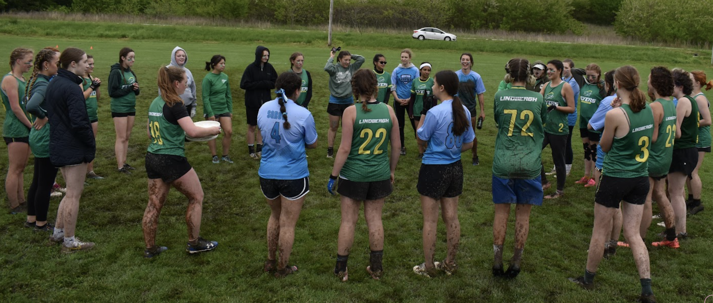 | `src/assets/circle.png` | 3580×1524 · **8.5 MB** | `components/Header.jsx`, `components/Rules.jsx`, `pages/MiddleSchool.jsx`, `pages/HighSchool.jsx`, `pages/Media.jsx`, `pages/PlayOpportunities.jsx`, `pages/PowerLunch.jsx`, `pages/Families.jsx`, `pages/BoosterClub.jsx`, `pages/USUltimate.jsx`, `pages/Fundraiser.jsx` | Girls team huddle photo. Used as a low-opacity hero/banner background on many pages, as the “Spirit Circle” image on Home > Rules, and as the third Power Lunch gallery tile. The name is generic; it is a photo, not a circular graphic. **Compress this first.** |

### Home page (`/`)

| Preview | File | Size | Used in | Context / notes |
| --- | --- | --- | --- | --- |
| 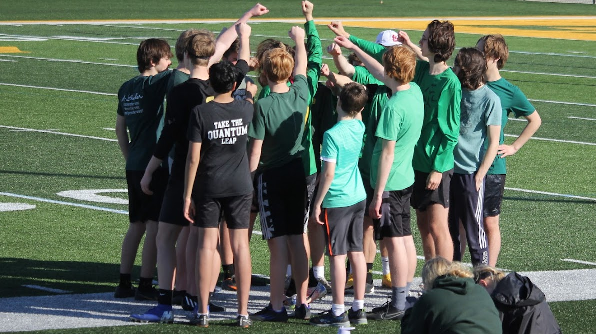 | `src/assets/welcome.png` | 1193×670 · **1.28 MB** | `components/Welcome.jsx` (Home) | Welcome photo. This replaced the 6.3 MB `whatIs.png`, which has been removed. |
| 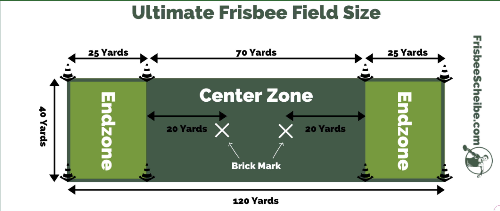 | `src/assets/ultimateRules.png` | 3584×1514 · 786.5 KB | `components/Rules.jsx` (Home) | Field-size diagram under “Ultimate in 10 Simple Rules.” Correctly named. `rules.png` is an unused smaller duplicate. |
| 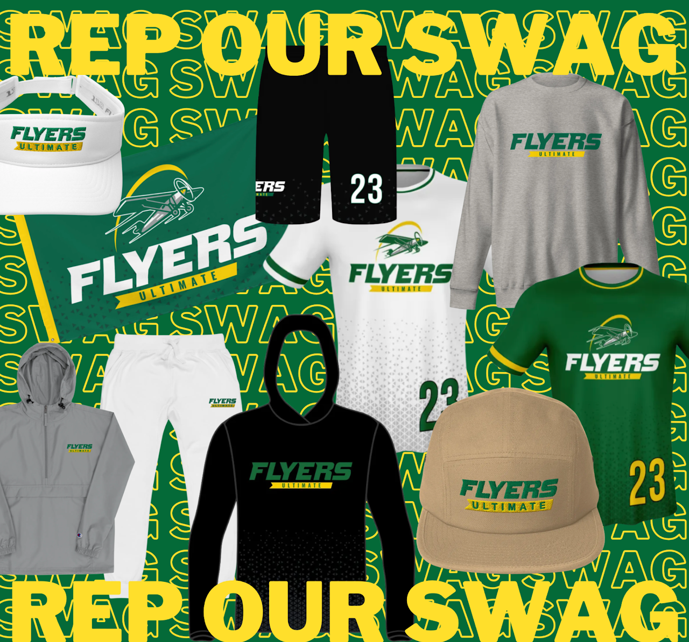 | `src/assets/swag.png` | 1280×1194 · **1.3 MB** | `components/Swag.jsx` (Home) | Team-store/swag collage. Correctly named, but large. |

### Middle School page (`/middle-school`)

| Preview | File | Size | Used in | Context / notes |
| --- | --- | --- | --- | --- |
|  | `src/assets/Lindbergh Ultimate - Grades 3-8.jpg` | 1280×719 · 398.6 KB | `pages/MiddleSchool.jsx`, `pages/Media.jsx` | Middle School: used on both program cards (“Fall After School Club” and “5 Week Community Ed Summer Camps”). Media: “Middle School,” “High School Spring Season 2023,” “High School Gxrls/Boys Spring Season 2021,” and “High School Gxrls Pre-2020” gallery covers. `fallmiddle.jpg` was byte-identical and has been removed. |

### High School page (`/high-school`)

| Preview | File | Size | Used in | Context / notes |
| --- | --- | --- | --- | --- |
| 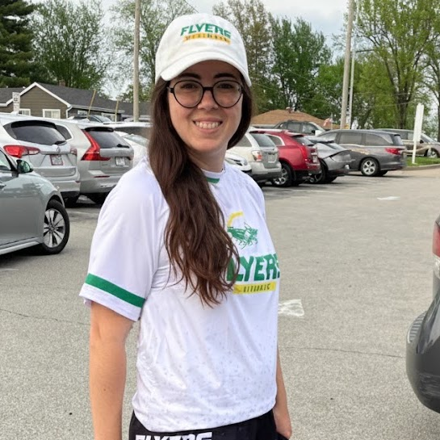 | `src/assets/gabby.jpg` | 545×545 · 92.2 KB | `pages/HighSchool.jsx`, `pages/BoosterClub.jsx` | **Gabby Lavezzi**, Boys Ultimate Coach. `unnamed(7).jpg` is a byte-identical duplicate. |
| 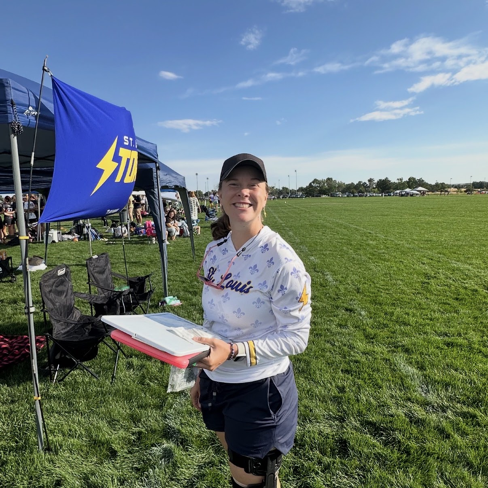 | `src/assets/coachT.jpg` | 1206×1206 · 486.7 KB | `pages/HighSchool.jsx`, `pages/BoosterClub.jsx` | **Kristina “T” Gu**, Gxrls Team Coach. `unnamed(5).jpg` is a byte-identical duplicate. |
|  | `src/assets/goods.jpg` | 946×946 · 169.1 KB | `pages/HighSchool.jsx`, `pages/BoosterClub.jsx` | **Loren “Goods” Goodrich**, Boys Team Coach. `unnamed(6).jpg` is a byte-identical duplicate. |
| 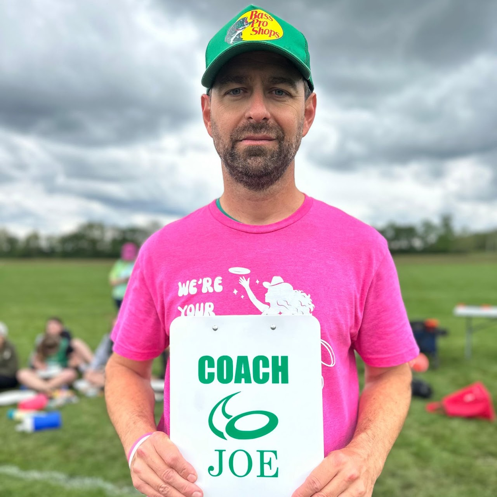 | `src/assets/joe.jpg` | 1280×1280 · 182.9 KB | `pages/HighSchool.jsx`, `pages/BoosterClub.jsx` | **Joe Corcoran**, Gxrls Team Coach and Booster Club President. The clipboard reads “COACH JOE.” |

### High School documents (`/high-school`)

| File | Size | Used in | Context / notes |
| --- | --- | --- | --- |
| `public/docs/Flyers-Info-Meeting-Slides-2026.pdf` | 8.0 MB · 12 pages | `pages/HighSchool.jsx` | 2026 interest-meeting slide deck. Opened in a new tab or downloaded from the slides card. |
| `public/docs/Flyers-Info-Meeting-Slides-2026-cover.png` | 720×405 · 213 KB | `pages/HighSchool.jsx` | First-page preview for the slides card. |
| `public/docs/Lindbergh-Ultimate-2026-Season-Letter-to-Families.pdf` | 3.0 MB · 5 pages | `pages/HighSchool.jsx` | 2026 season letter/info packet. Opened in a new tab or downloaded from the info-packet card. |
| `public/docs/Lindbergh-Ultimate-2026-Season-Letter-to-Families-cover.png` | 612×792 · 152 KB | `pages/HighSchool.jsx` | First-page preview for the season-letter card. |

### Media page (`/media`)

| Preview | File | Size | Used in | Context / notes |
| --- | --- | --- | --- | --- |
|  | `src/assets/Lindbergh Ultimate - Media.jpg` | 1280×731 · 266.4 KB | `pages/Media.jsx` | “All Star Game 2025” and “Gxrls Missouri State Tournament 2023” gallery covers. Generic team photo; verify it matches those events. |
|  | `src/assets/Lindbergh Ultimate - Play Opportunities.jpg` | 1280×719 · 258.8 KB | `pages/Media.jsx`, `pages/PlayOpportunities.jsx` | Media: “High School Spring Season 2025” and “High School Spring Season 2022” covers. Play Opportunities: Lindbergh Players Pickup GroupMe card. The photo is a high school team lineup; verify it is appropriate for the pickup card. |
|  | `src/assets/Lindbergh Ultimate - Power Lunch.jpg` | 1280×1279 · 216.6 KB | `pages/Media.jsx`, `pages/PowerLunch.jsx` | Media: “High School Spring Season 2024” cover. Power Lunch: first gallery tile. Indoor gym action; name matches the Power Lunch context. |
| `Grades 3-8.jpg` | see above | — | `pages/Media.jsx` | Used for “High School Spring Season 2023,” “Gxrls Pre-2020,” “Middle School,” and “Spring Season 2021” covers. These are middle-school group photos, so verify the High School gallery covers. |

### Families page (`/families`)

| Preview | File | Size | Used in | Context / notes |
| --- | --- | --- | --- | --- |
| 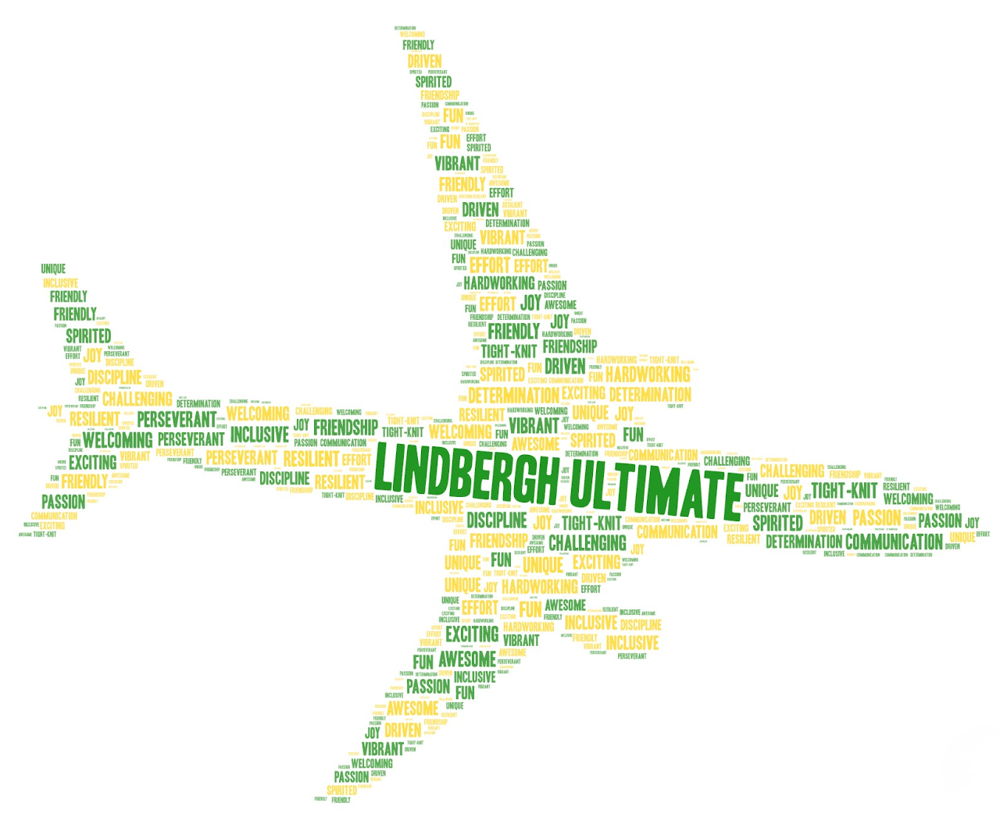 | `src/assets/wordCloud.png` | 1280×1047 · 590 KB | `pages/Families.jsx` | Supplied word cloud in the “Describe Lindbergh Ultimate in Three Words” section. It has a solid white background, so it is displayed on a cream rounded card. The previous interactive `<WordCloud />` block remains in the file, commented out for reference. |

### Booster Club page (`/booster-club`)

| Preview | File | Size | Used in | Context / notes |
| --- | --- | --- | --- | --- |
|  | `src/assets/joe.jpg` | 1280×1280 · 182.9 KB | `pages/BoosterClub.jsx` | Joe Corcoran, President. The clipboard reads “COACH JOE.” |
|  | `src/assets/traci.jpg` | 1280×1280 · 261.0 KB | `pages/BoosterClub.jsx` | Traci Lichtenberg, Secretary. |
| 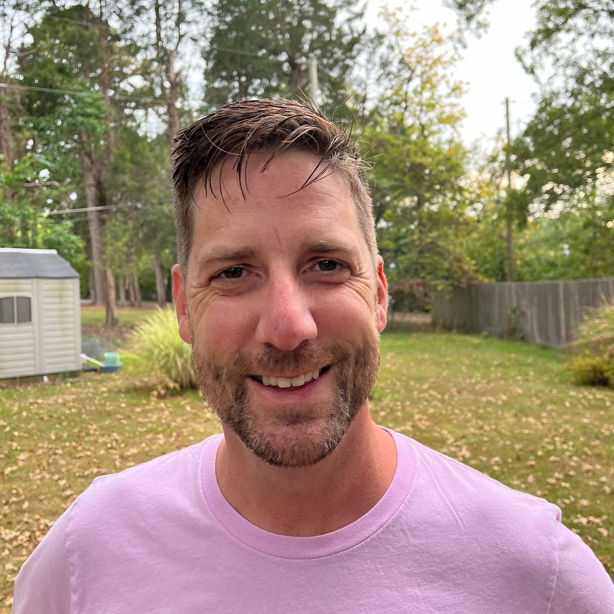 | `src/assets/jeff.jpg` | 1280×1280 · 343.2 KB | `pages/BoosterClub.jsx` | Chris Dollenmeyer, Co-Treasurer. |
| 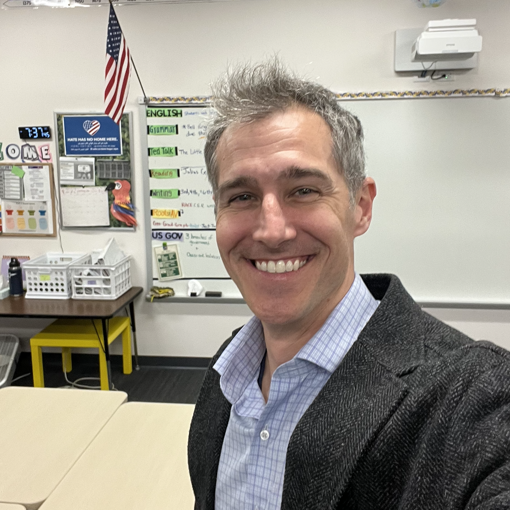 | `src/assets/dave.png` | 1078×1078 · **1.7 MB** | `pages/BoosterClub.jsx` | Dave Valentine-Elam, Co-Treasurer. |
|  | `src/assets/glenn.jpg` | 321×321 · 23.7 KB | `pages/BoosterClub.jsx` | Jeff Glotfelty, Vice-President. |
| 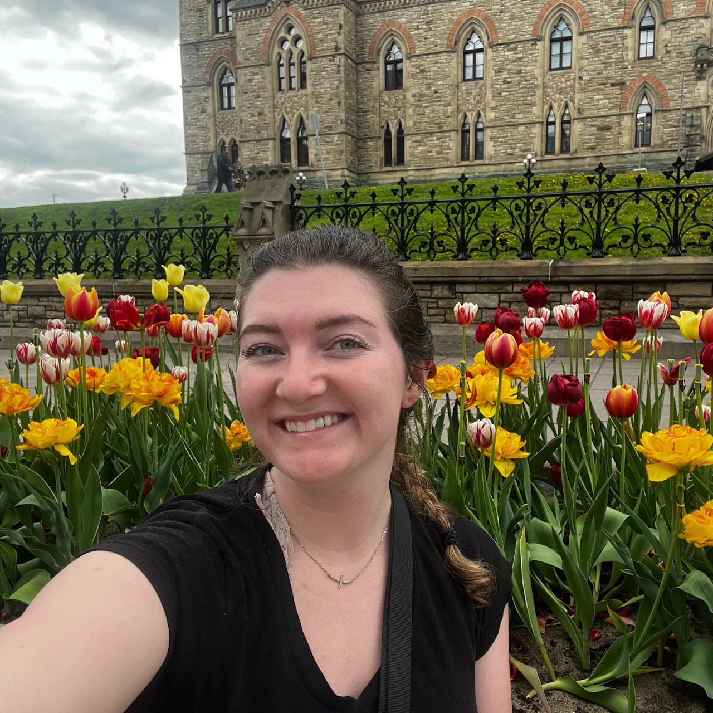 | `src/assets/evie.jpg` | 1280×1280 · 409 KB | `pages/BoosterClub.jsx` | Evie Reed, Alumni Rep. |
|  | `src/assets/coachT.jpg` | 1206×1206 · 486.7 KB | `pages/BoosterClub.jsx`, `pages/HighSchool.jsx` | Kristina “T” Gu, Gxrls Team Coach. `unnamed(5).jpg` is a byte-identical duplicate. |
|  | `src/assets/gabby.jpg` | 545×545 · 92.2 KB | `pages/BoosterClub.jsx`, `pages/HighSchool.jsx` | Gabby Lavezzi, Boys Team Coach. `unnamed(7).jpg` is a byte-identical duplicate. |
|  | `src/assets/goods.jpg` | 946×946 · 169.1 KB | `pages/BoosterClub.jsx`, `pages/HighSchool.jsx` | Loren “Goods” Goodrich, Boys Team Coach. `unnamed(6).jpg` is a byte-identical duplicate. |
|  | `src/assets/blankAvatar.svg` | 400×400 · <1 KB | `pages/BoosterClub.jsx` | Neutral silhouette used for the three open positions (Middle School Rep, Gxrls Team Historian, Boys Team Historian). The card keeps the role label and a dashed yellow border. |

All portraits and the blank avatar use the `.booster-photo-shadow` utility in `src/index.css`, which adds a Lindbergh-yellow glow.

### Power Lunch page (`/power-lunch`)

| Preview | File | Size | Used in | Context / notes |
| --- | --- | --- | --- | --- |
| 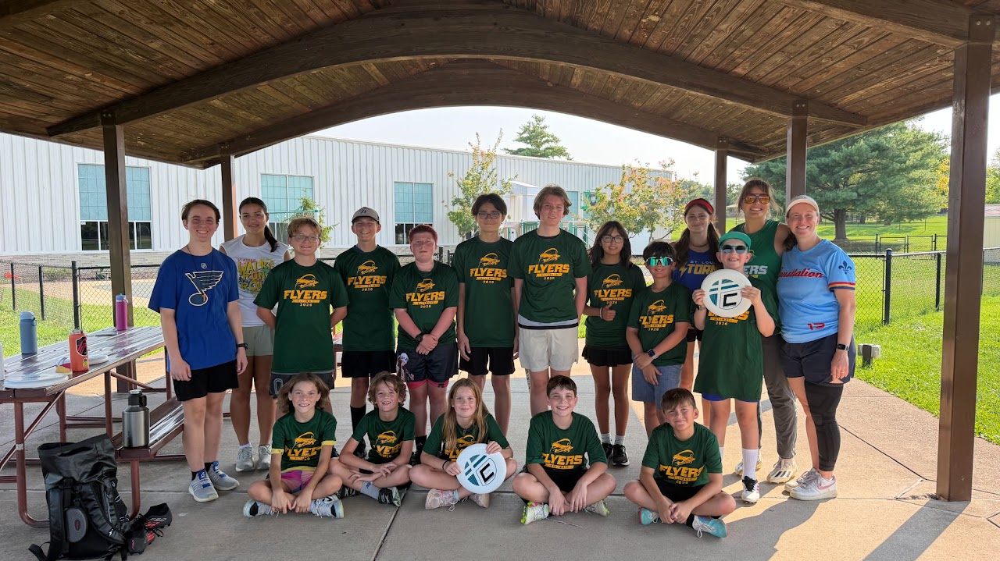 | `src/assets/5week.jpg` | 1280×719 · 288.0 KB | `pages/PowerLunch.jsx` | Second gallery tile on Power Lunch. The image shows a middle-school group under a pavilion in Flyers gear; it looks like a 5 Week Summer Camps photo, not Power Lunch. **Likely belongs on `/middle-school` instead.** |
| `circle.png` | see above | — | `pages/PowerLunch.jsx` | Third gallery tile; generic team huddle. Consider replacing with a real Power Lunch photo. |

---

## Browser icons (`public/`)

| File | Size | Referenced by | Notes |
| --- | --- | --- | --- |
| `public/favicon.ico` | 15.0 KB | `index.html` (`/favicon.ico`) | Primary browser icon. Good. |
| `public/favicon-32x32.png` | 1.3 KB | `index.html` | 32×32 PNG icon. |
| `public/favicon-16x16.png` | 0.6 KB | `index.html` | 16×16 PNG icon. |
| `public/apple-touch-icon.png` | 14.4 KB | `index.html` | 180×180 Apple touch icon. |
| `public/android-chrome-192x192.png` | 15.2 KB | not referenced | Add a `site.webmanifest` to use these, or remove them. |
| `public/android-chrome-512x512.png` | 73.9 KB | not referenced | Same as above. |
| `public/favicon.svg` | 0.3 KB | not referenced | **Misnamed:** the file contains PNG data, not SVG. It is identical to `LindberghSchoolsfavicon_1.png`. Remove it or replace it with a real SVG. |
| `public/icons.svg` | 4.9 KB | not referenced | Unused icon sprite. Verify before deleting. |

---

## External images / placeholders

| Source | Where | Notes |
| --- | --- | --- |
| YouTube embed `PrinnxHyWlo` | `components/WhatIs.jsx` | “What is Ultimate?” video. |
| YouTube embeds with empty IDs | `pages/Media.jsx` | Two video placeholders until real YouTube IDs are added. |
| “Image” text box | `pages/Fundraiser.jsx` | Campaign image placeholder; not a file. |

---

## Unused assets

These files are **not imported anywhere** in the current React code. Keep the ones you still need; remove the rest before pushing to GitHub to keep the repo small.

### Likely useful — inspect before deleting

| File | Size | What it appears to be / recommendation |
| --- | --- | --- |
| `src/assets/openPosition.jpg` | 253×253 · 5.3 KB | “OPEN POSITION” stamp graphic. No longer used; open Booster Club seats now use `blankAvatar.svg`. |
| `src/assets/unnamed(11).jpg` | 350×350 · 30.5 KB | Another “OPEN POSITION” stamp; visually similar to `openPosition.jpg` but a different file. No longer used. |
| `src/assets/unnamed(5).jpg` | 1206×1206 · 486.7 KB | Byte-identical duplicate of `coachT.jpg` (Kristina “T” Gu). |
| `src/assets/unnamed(6).jpg` | 946×946 · 169.1 KB | Byte-identical duplicate of `goods.jpg` (Loren “Goods” Goodrich). |
| `src/assets/unnamed(7).jpg` | 545×545 · 92.2 KB | Byte-identical duplicate of `gabby.jpg` (Gabby Lavezzi). |
| `src/assets/3.jpg` | 1245×1245 · 236.1 KB | Indoor gym Ultimate action; possible alternate Power Lunch image. |
| `src/assets/Lindbergh Ultimate - Play Opportunities.png` | 863×485 · 60.4 KB | **Not a photo:** it is the St. Louis Ultimate Association (STLUA) logo. Byte-identical duplicate of `slua.png`; use `slua.png` on `/play-opportunities`. |
| `src/assets/slua.png` | 863×485 · 60.4 KB | St. Louis Ultimate Association logo used for the right-hand partner card on `/play-opportunities`. |
| `src/assets/Lindbergh Ultimate - Power Lunch.png` | 294×294 · 102.0 KB | Small indoor gym action image; a thumbnail-sized Power Lunch alternate. The duplicate `2.png` was removed. |
| `src/assets/rules.png` | 1100×445 · 20.1 KB | Small duplicate of `ultimateRules.png` field diagram. |
| `src/assets/ultimateLogo.png` | 174×102 · 5.2 KB | Small/older logo; the transparent 2048×1318 version is used instead. |
| `src/assets/LindberghSchools.png` | 256×85 · 2.6 KB | Lindbergh Schools logo; not referenced. |
| `src/assets/LindberghSchoolsfavicon_1.png` | 32×32 · 0.3 KB | Old favicon; identical to `public/favicon.svg`. |
| `src/assets/unnamed.png` | 2048×1318 · 148.6 KB | Flyers Ultimate logo; duplicate of `ultimateLogoTransparent.png`. |

### Removed during cleanup

These files were unreferenced duplicates, build leftovers, or replaced images and have been deleted:

- `whatIs.png` — replaced by the smaller `welcome.png` on Home.
- `fallmiddle.jpg` — byte-identical to `Grades 3-8.jpg`; references replaced on Middle School and Media.
- `circle-CPrB7h4u.png` — byte-identical build-hash copy of `circle.png`.
- `1.jpg` — byte-identical to `Lindbergh Ultimate - Power Lunch.jpg`.
- `2.png` — byte-identical to `Lindbergh Ultimate - Power Lunch.png`.
- `unnamed(1).jpg` — byte-identical to `jeff.jpg`.
- `unnamed(2).jpg` — byte-identical to `traci.jpg`.
- `unnamed(3).jpg` — byte-identical to `glenn.jpg`.
- `unnamed(4).png` — byte-identical to `dave.png`.
- `unnamed(8).jpg` — byte-identical to `evie.jpg`.
- `Grades 3-8_thumbnail.png`, `Media_thumbnail.png`, `Play Opportunities_thumbnail.png`, `Power Lunch_thumbnail.png` — unused gallery thumbnails.

---

## Cleanup status and remaining decisions

Completed in this pass:

- Replaced `whatIs.png` with `welcome.png` on Home.
- Replaced `fallmiddle.jpg` with `Lindbergh Ultimate - Grades 3-8.jpg` on Middle School and Media.
- Deleted the byte-identical duplicates, build-hash copy, and unused gallery thumbnails.
- Fixed the broken favicon links.
- Made the navbar logo background transparent.
- Updated the footer to a two-column layout at `md` and above, with a two-column link grid on smaller screens.
- Added Font Awesome icons to the footer’s Admin Panel and Interest Form links.
- Replaced the interactive word cloud with the supplied `wordCloud.png` on Families; the interactive block is retained in comments.
- Added the Coaching Apprenticeship page, which reuses `circle.png` as its hero image.
- Replaced the Booster Club’s external `i.pravatar.cc` avatars with local portraits, added a neutral blank avatar for open seats, and added a Lindbergh-yellow glow to every Booster Club image.

Remaining owner decisions:

1. Choose the final Media gallery covers so each year/event has a matching photo.
2. Decide whether the Middle School summer-camp card should keep `Grades 3-8.jpg` or use `5week.jpg`.
3. Compress `circle.png`, `dave.png`, `welcome.png`, and `swag.png`; ideally convert them to WebP.
4. Add a `site.webmanifest` to use the Android Chrome icons, or remove the icons.
5. Review the remaining unreferenced assets (`openPosition.jpg`, the duplicate `unnamed` portraits, the logo variants, and `rules.png`).

---

## Quick verification commands

```bash
# List every image file and its dimensions
find src/assets public -type f \( -iname '*.png' -o -iname '*.jpg' -o -iname '*.jpeg' -o -iname '*.webp' -o -iname '*.gif' -o -iname '*.svg' -o -iname '*.ico' \) -print

# Find every image import in the React source
grep -RIn --include='*.jsx' --include='*.js' -E '\.(png|jpe?g|webp|gif|svg|avif)' src

# Find duplicate files by hash (macOS/Linux with shasum)
find src/assets public -type f -print0 | xargs -0 shasum -a 256 | sort
```
